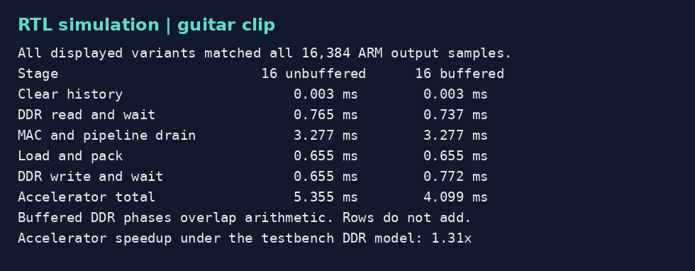

# NEON ARM and buffered FPGA evaluation

The ARM benchmark retains the two pinned worker cores. The NEON kernel
computes four neighboring outputs at once, using two independent widened
accumulators. It includes input preparation, thread dispatch, and completion
in the timed region. The kernel checks that each partial sum fits in 32 bits
for any signed 16-bit input with the current coefficients. If adding the
partial sums exceeds 32-bit range, the result already lies beyond the final
16-bit PCM saturation threshold.

The buffered FPGA keeps the same 128-tap coefficients and symmetric
16-tap-per-clock arithmetic. A one-beat input mailbox reads ahead while the
arithmetic pipeline works. A separate output mailbox holds each 64-bit result
beat until its DDR write is acknowledged. The memory FSM allows a single
outstanding transaction and prioritizes queued writes. These transfers still
use single beats. Completion waits for the last write response. Bus counters
report time spent submitting and waiting on each transaction, and may overlap
the arithmetic states. The accelerator total comes from a dedicated elapsed
counter.

## Correctness and simulated cycles

- The Cortex-A9-targeted binary contains NEON widening multiply-accumulate
  instructions. Under QEMU, 15 trials each on the guitar and full-scale stress
  clips matched the scalar output on every sample. Emulation timings are
  excluded from the speed comparison.
- Both FPGA versions matched all 16,384 ARM outputs under simulated bus stalls.
  A separate slow-response stress test also passed the buffered data, address,
  command-stability, and completion checks.

| Testbench DDR model | 16 taps, unbuffered | 16 taps, buffered |
| --- | ---: | ---: |
| MAC and drain | 163,840 cycles | 163,840 cycles |
| Accelerator elapsed | 267,732 cycles | 204,942 cycles |
| Accelerator elapsed at 50 MHz | 5.355 ms | 4.099 ms |

Buffering saved 62,790 simulated accelerator clocks, a 1.31× improvement
under this bus model. These numbers exclude host staging, IRQ handling, and
output copy.

A physical-board comparison requires working board access. The VM detected the
USB gadget, but the board did not respond to USB Ethernet address resolution at
the existing SSH address, even with a temporary host-side IPv4 address.

## Quartus implementation

The buffered firmware compiled and passed the 50 MHz FPGA clock timing checks.
The minimum setup and hold slacks were +4.066 ns and +0.121 ns. The fitted
design used 12,744 of 41,910 ALMs, 8 of 112 DSP blocks, and 6 of 553 RAM
blocks. The generated firmware and overlay passed checksum verification.
The buffered firmware was not loaded because USB Ethernet remained unreachable.
