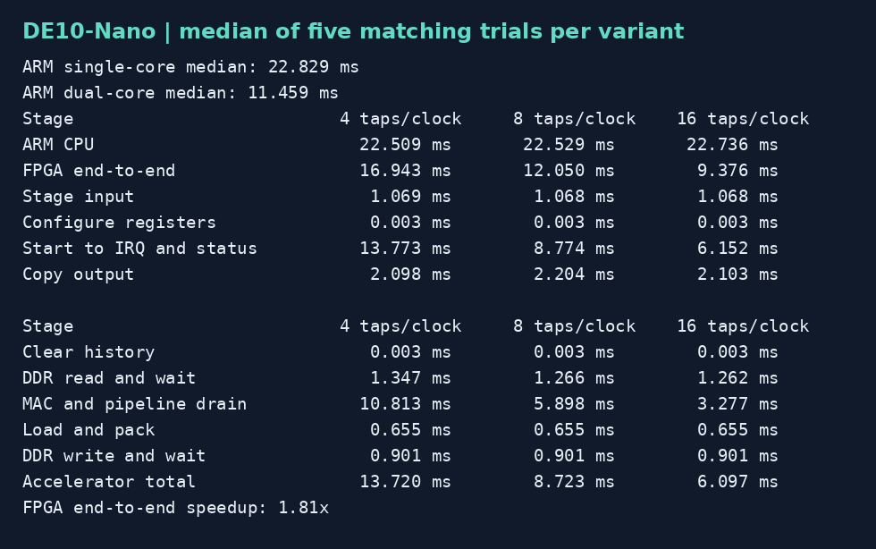

# Dual-core ARM and wider FPGA benchmarking

The experiment holds the clip, 128 coefficients, fixed-point arithmetic,
50 MHz FPGA clock, and bit-for-bit acceptance criteria constant. It changes
the compute parallelism. The input is the same 16,384-sample guitar-style
pluck used for the prior board benchmark.

## Dual-core implementation

Both modes use the same C FIR kernel. A persistent worker handles the second
half while the caller handles the first half. The worker seeds its ring buffer
with the 127 samples preceding the split, so resetting a job does not introduce
a discontinuity at the midpoint. The threads are pinned to the two available
CPU IDs and write to disjoint halves of the same output. Measured time includes
dispatch and completion synchronization. Worker startup and a warmup are
outside the measured trials, and single- and dual-core order alternates.

On the stock DE10-Nano, 15 trials produced medians of 22.901 ms on one ARM core
and 11.444 ms on two cores, a **2.00× speedup**. All 16,384 samples matched in
every trial. The same comparison is run again during the paired board session.

## Wider FPGA implementation

Eight taps per clock use four multipliers, and 16 taps per clock use eight.
The coefficients are mirrored, so each multiplier uses the signed 17-bit sum
of a pair of samples and one coefficient. The pre-add and product stages are
registered, with two drain clocks per output. The accumulator is rounded only
once, after the whole sample. Builds check the coefficient symmetry.

| RTL mode | Arithmetic clocks per output | Simulated total cycles |
| --- | ---: | ---: |
| Four taps per clock | 33 | 650,024 |
| Eight taps per clock | 18 | 401,536 |
| Sixteen taps per clock | 10 | 267,732 |

These totals use the testbench DDR model. It checks the returned samples,
backpressure, DDR addresses, interrupt ordering, and hardware cycle counters.

The wider variants also passed a separate RTL stress run with full-scale and
random signed PCM values. The ARM split was checked on that input as well.

[Stock-image ARM trial log](arm-dual-board.txt)

## Paired measurements on the DE10-Nano

The four-, eight-, and sixteen-tap FPGA images each ran five trials during the
same board session as 15 pinned ARM trials. All trials agreed bit-for-bit on
all 16,384 outputs. Each FPGA timing includes host input staging, FPGA work,
the completion interrupt, and copying the result out.

| Implementation | Median elapsed time | FPGA arithmetic | Whole-design ALMs | DSP blocks |
| --- | ---: | ---: | ---: | ---: |
| ARM, one core | 22.829 ms | — | — | — |
| ARM, two cores | 11.459 ms | — | — | — |
| FPGA, four taps per clock | 16.943 ms | 10.813 ms | 6,657 of 41,910 | 4 of 112 |
| FPGA, eight taps per clock | 12.050 ms | 5.898 ms | 8,601 of 41,910 | 4 of 112 |
| FPGA, sixteen taps per clock | **9.376 ms** | **3.277 ms** | 12,696 of 41,910 | 8 of 112 |

The dual-core C reference is **1.99× as fast** as the single-core reference.
The eight-tap FPGA took 0.591 ms longer than dual-core ARM. The sixteen-tap
FPGA saved 2.083 ms relative to dual-core ARM, a **1.22× speedup**. All FPGA
variants used six RAM blocks and met the 50 MHz timing constraint. Worst
setup/hold slack was +2.894/+0.125 ns (four), +4.445/+0.123 ns (eight),
and +3.825/+0.129 ns (sixteen).

With sixteen taps per clock, roughly 6.10 ms of the end-to-end run is outside
tap arithmetic. Host input staging and output copy account for about 3.17 ms,
and FPGA DDR reads and writes, including waits, account for about 2.16 ms.
The table compares this dual-core C implementation with the FPGA on one fixed
clip. The dual-core implementation uses the same direct FIR arithmetic as the
single-core baseline, and the FPGA variants above four taps exploit symmetry.

[ARM trial capture](arm-dual-board.png) · [All board trials](fir-multicore-board-trials.txt)

Stock recovery was verified after reboot. The stock overlay was applied, the FPGA manager was operating, and all eight stock FPGA LEDs were present.
