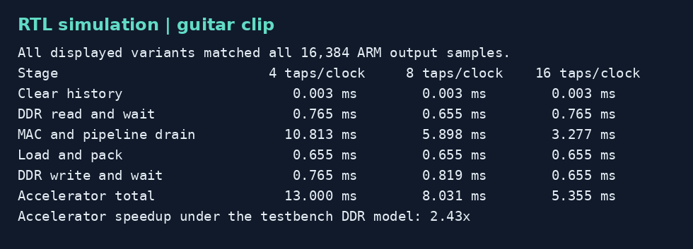

# Dual-core ARM and wider FPGA benchmarking

The experiment holds the clip, 128 coefficients, fixed-point arithmetic,
50 MHz FPGA clock, and bit-for-bit acceptance criteria constant. It changes
the compute parallelism. The input is the same 16,384-sample guitar-style
pluck used for the prior board benchmark.

## Dual-core implementation

Both modes use the same C FIR kernel. A persistent worker handles the second
half while the caller handles the first half. The worker seeds its ring buffer
with the 127 samples preceding the split, so resetting a job does not introduce
a discontinuity at the midpoint. The threads are pinned to the two available
CPU IDs and write to disjoint halves of the same output. Measured time includes
dispatch and completion synchronization. Worker startup and a warmup are
outside the measured trials, and single- and dual-core order alternates.

On the stock DE10-Nano, 15 trials produced medians of 22.901 ms on one ARM core
and 11.444 ms on two cores, a **2.00× speedup**. All 16,384 samples matched in
every trial. The same comparison is run again during the paired board session.

## Wider FPGA implementation

Eight taps per clock use four multipliers, and 16 taps per clock use eight.
The coefficients are mirrored, so each multiplier uses the signed 17-bit sum
of a pair of samples and one coefficient. The pre-add and product stages are
registered, with two drain clocks per output. The accumulator is rounded only
once, after the whole sample. Builds check the coefficient symmetry.

| RTL mode | Arithmetic clocks per output | Simulated total cycles |
| --- | ---: | ---: |
| Four taps per clock | 33 | 650,024 |
| Eight taps per clock | 18 | 401,536 |
| Sixteen taps per clock | 10 | 267,732 |

These totals use the testbench DDR model. It checks the returned samples,
backpressure, DDR addresses, interrupt ordering, and hardware cycle counters.

The wider variants also passed a separate RTL stress run with full-scale and
random signed PCM values. The ARM split was checked on that input as well.

[Stock-image ARM trial log](arm-dual-board.txt)
