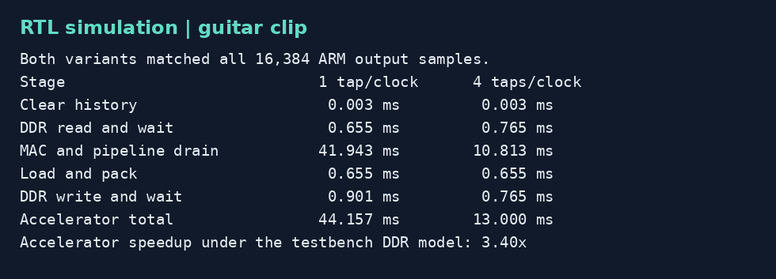

# FPGA profiling and four taps per clock

The one-tap baseline and the four-tap implementation use the same 16,384-sample
guitar input, Q1.15 coefficients, output quantization, single-beat DDR
transactions, interrupt path, and 50 MHz FPGA clock. The four-tap path issues
four signed products per clock, combines them at expanded width, and drains the
registered final group in an extra clock per output. It preserves the exact
integer sum before rounding.

## What the timers count

Host timings bracket sample staging, CSR programming, start through interrupt
and status, and output copy. Hardware counters cover all busy accelerator
states. The hardware subtotal is contained in the host IRQ interval. DDR read
and write counters include the command clock, backpressure, and response wait.
Convert FPGA cycles to milliseconds by dividing by 50,000.

## RTL simulation

Both variants matched all 16,384 samples of the two-tone integer oracle and
the measured ARM guitar output. The testbench independently counted the DDR
phases and checked the sum of all counters against elapsed accelerator cycles.

| FPGA state | One tap/clock | Four taps/clock |
| --- | ---: | ---: |
| Clear history | 128 | 128 |
| DDR read and wait | 32,768 | 38,228 |
| MAC and drain | 2,097,152 | 540,672 |
| Load and pack | 32,768 | 32,768 |
| DDR write and wait | 45,056 | 38,228 |
| **Total** | **2,207,872** | **650,024** |

The modeled total fell from 44.157 ms to 13.000 ms at 50 MHz, a **3.40×**
accelerator-only speedup in simulation. The different DDR totals come from the
different arrival phases relative to the same periodic backpressure pattern.
They model the simulated bus and are separate from board measurements.

