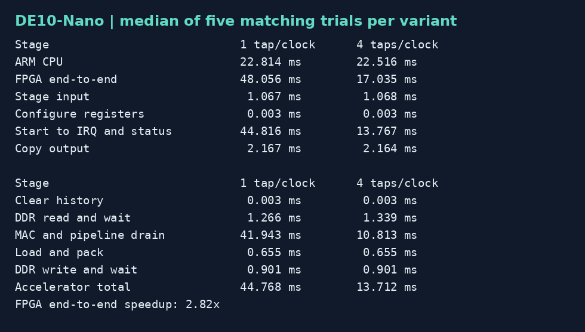

# FPGA profiling and four taps per clock

The one-tap baseline and the four-tap implementation use the same 16,384-sample
guitar input, Q1.15 coefficients, output quantization, single-beat DDR
transactions, interrupt path, and 50 MHz FPGA clock. The four-tap path issues
four signed products per clock, combines them at expanded width, and drains the
registered final group in an extra clock per output. It preserves the exact
integer sum before rounding.

## What the timers count

Host timings bracket sample staging, CSR programming, start through interrupt
and status, and output copy. Hardware counters cover all busy accelerator
states. The hardware subtotal is contained in the host IRQ interval. DDR read
and write counters include the command clock, backpressure, and response wait.
Convert FPGA cycles to milliseconds by dividing by 50,000.

## RTL simulation

Both variants matched all 16,384 samples of the two-tone integer oracle and
the measured ARM guitar output. The testbench independently counted the DDR
phases and checked the sum of all counters against elapsed accelerator cycles.

| FPGA state | One tap/clock | Four taps/clock |
| --- | ---: | ---: |
| Clear history | 128 | 128 |
| DDR read and wait | 32,768 | 38,228 |
| MAC and drain | 2,097,152 | 540,672 |
| Load and pack | 32,768 | 32,768 |
| DDR write and wait | 45,056 | 38,228 |
| **Total** | **2,207,872** | **650,024** |

The modeled total fell from 44.157 ms to 13.000 ms at 50 MHz, a **3.40×**
accelerator-only speedup in simulation. The different DDR totals come from the
different arrival phases relative to the same periodic backpressure pattern.
They model the simulated bus and are separate from board measurements.

## Measured on the DE10-Nano

Both images passed setup and hold timing at 50 MHz. Quartus synthesis used
one DSP block for the serial image and four for parallel. The minimum setup
and hold slacks were +4.058 ns and +0.115 ns for serial, and +2.894 ns and
+0.125 ns for parallel.

Five trials per image used the same generated guitar clip. All ten FPGA outputs
matched the ARM output on all 16,384 samples, and the retrieved output files
also matched across trials. The serial trials ran first, followed by parallel.
Each row reports its own median.

| Timing | One tap/clock | Four taps/clock |
| --- | ---: | ---: |
| ARM reference | 22.814 ms | 22.516 ms |
| **FPGA end to end** | **48.056 ms** | **17.035 ms** |
| Host input staging | 1.067 ms | 1.068 ms |
| Host register setup | 0.003 ms | 0.003 ms |
| Host start through IRQ and status | 44.816 ms | 13.767 ms |
| Host output copy | 2.167 ms | 2.164 ms |
| FPGA clear history | 0.003 ms | 0.003 ms |
| FPGA DDR read and wait | 1.266 ms | 1.339 ms |
| FPGA MAC and pipeline drain | 41.943 ms | 10.813 ms |
| FPGA load and pack | 0.655 ms | 0.655 ms |
| FPGA DDR write and wait | 0.901 ms | 0.901 ms |
| **FPGA accelerator subtotal** | **44.768 ms** | **13.712 ms** |

The four-tap FPGA path was **2.82× as fast** as the serial FPGA path end to
end, and **1.32× as fast** as its paired ARM reference by the ratio of medians.
Serial FPGA times ranged from 48.054 to 48.155 ms. Parallel FPGA times ranged
from 16.999 to 17.124 ms. The MAC stage saved 31.130 ms, while DDR and
host-side staging times stayed close to their prior values. Arithmetic drove
the speedup. Input staging and output copy still cost about 3.23 ms combined
for the parallel image.

[All ten trial logs](fir-profiling-board-trials.txt)

After copying the results, the board rebooted into its stock image. A new boot
ID, the applied stock overlay, the operating FPGA manager, and all eight stock
FPGA LED devices were verified over SSH.
